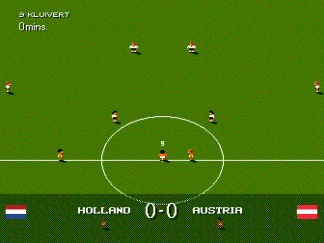

# OpenSWOS on Miyoo Mini



## Build

Put the OpenSWOS Git checkout in the shared workspace of the [Union Miyoo Mini toolchain](https://github.com/shauninman/union-miyoomini-toolchain).
Run `make shell` from the toolchain directory to enter the container. Inside the container, go to the OpenSWOS repository root and run:

```sh
apt-get update
apt-get install -y autoconf automake libtool pkg-config cmake git zip
git submodule update --init third_party/ggpo-x
sh miyoo/build-sdl2.sh
sh miyoo/miyoo_build.sh
```

The container sets `CROSS_COMPILE`. The SDL2 script builds the Miyoo video and audio drivers and puts the headers and libraries in `miyoo/include/` and `miyoo/lib/`. Run it again when you need to rebuild SDL2. The OpenSWOS build produces `bin/SWOS.miyoo`.

## Package and install

From the same repository root, run:

```sh
sh miyoo/miyoo_pack.sh
```

The packer copies the binary, SDL2 runtime libraries, launcher, icon, and tracked game resources into `dist/miyoo/App/OpenSWOS/`. It also creates `dist/miyoo/OpenSWOS.zip` with `App/` at the archive root.

Extract the ZIP at the root of your OnionOS SD card. The packer archives everything under `dist/miyoo/App/`, so add your game assets directly to the SD card if you want to keep them out of future ZIPs.

## Game assets

Use OpenSWOS Setup on your computer to generate the assets from your own copy of Sensible World of Soccer 96/97. Either the PC or the Amiga version is enough.
If you have both, add both to include the Amiga music and sound effects.
[Official OpenSWOS installation guide](https://openswos.net/install/)

1. In OpenSWOS Setup, select your game source and complete the **Install** step.
2. Open the generated `assets/` folder. Common locations are
   `Documents\SWOS\assets` on Windows, `~/Library/Application Support/SWOS/assets` on macOS, and `~/.swos/assets` on Linux.
3. Copy the whole `assets/` folder into `App/OpenSWOS/` on the SD card, next to `SWOS.miyoo`. Check that `ASSETS.ini` is directly at `App/OpenSWOS/assets/ASSETS.ini`.

## Launch and controls

Launch **OpenSWOS** from **Apps** in OnionOS. For startup errors, check `App/OpenSWOS/launch.log` and `App/OpenSWOS/conf/.swos/SWOS.log`.

The D-pad moves the player. **A** and **B** fire, and **B** also skips.
**Start** pauses, **Select** shows statistics, **Y** requests an instant replay, and **X** requests the replay after a match. Use **L2** for Escape, **Select + Start** to quit OpenSWOS.

Text fields open an on-screen keyboard. Use the D-pad to choose a character,
**A** to type it, **B** to delete, **Start** to confirm, and **L2** or **R2** to cancel.
